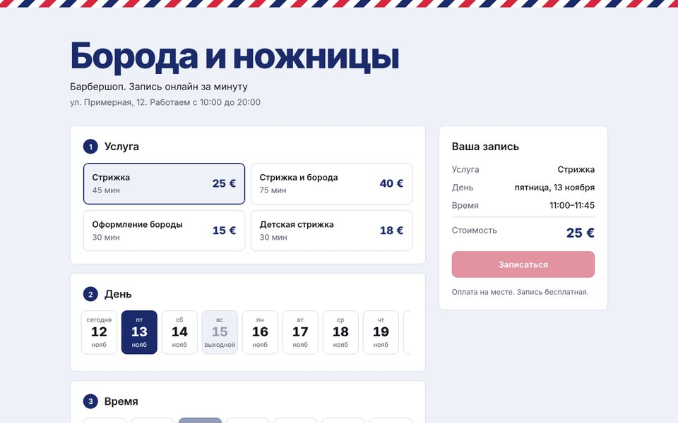

# Онлайн-запись с Telegram-ботом

Сервис записи для малого бизнеса: барбершопа, мастера, репетитора. Клиент выбирает услугу, день и время
за полминуты, а владелец сразу получает сообщение в Telegram и подтверждает или отменяет запись одной кнопкой.



## Как это работает

1. **Клиент** открывает страницу, выбирает услугу, день и свободное время, оставляет имя и телефон.
2. **Владелец** получает в Telegram сообщение о новой записи с кнопками «Подтвердить» и «Отменить».
3. **Время сразу освобождается**, если запись отменена, и становится доступным другим клиентам.

## Что умеет

- Пошаговая запись: услуга, день, время, контакты. Занятое время показано зачёркнутым.
- Два клиента не могут занять одно и то же время, даже если нажали кнопку одновременно.
- Уведомления в Telegram с кнопками. Команда `/today` показывает записи на сегодня.
- Админка по адресу `/#/admin`: записи по дням, подтверждение и отмена.
- Правила расписания: рабочие часы, выходные, запись не позже чем за час до визита, горизонт 21 день, одна запись в день на один телефон.
- Работает на телефоне и на компьютере.

## Самое интересное: защита от двойной записи

Расписание разбито на ячейки по 15 минут. Когда клиент записывается, сервер ставит на каждую нужную ячейку
замок командой `SET key value NX` («записать, только если ключа ещё нет»). Команда атомарна, поэтому из двух
одновременных запросов побеждает один. Второй получает ответ 409 («время занято»), а замки, которые он успел
взять, снимаются.

Код: функция `createBooking` в `lib/bookings.js`. Проверка: тест с 10 одновременными запросами в `test/bookings.test.js`.

## Технологии

- **Интерфейс:** React 19 и Vite, без UI-библиотек и роутера.
- **Сервер:** Node.js, серверные функции Vercel. Без зависимостей: только встроенные `fetch` и `crypto`.
- **База данных:** Upstash Redis (REST API).
- **Бот:** Telegram Bot API, вебхук с секретным заголовком.
- **Тесты:** встроенный `node:test`.

## Структура проекта

```
api/        серверные функции: config, slots, bookings, telegram, admin/*
lib/        логика: bookings.js (слоты и запись), store.js (хранилище), telegram.js, time.js, config.js
src/        React: Booking.jsx (страница записи), Admin.jsx (админка)
scripts/    локальный сервер, который запускает функции так же, как Vercel
test/       тесты логики
```

## Запустить у себя

```bash
npm install
npm run api      # сервер на http://localhost:3001
npm run dev      # страница на http://localhost:5173 (в соседнем терминале)
npm test         # тесты
```

Без настроек данные хранятся в файле, пароль админки `admin`, Telegram выключен. Так можно всё попробовать без бота и базы.

<details>
<summary>Развернуть на Vercel вместе с Telegram-ботом</summary>

1. Импортируйте репозиторий в Vercel. Сборка определится сама (Vite).
2. В разделе Storage создайте базу Upstash Redis и подключите её к проекту без префикса: переменные добавятся автоматически.
3. В Settings → Environment Variables добавьте `ADMIN_PASSWORD`.
4. Создайте бота у [@BotFather](https://t.me/BotFather), добавьте токен в `TELEGRAM_BOT_TOKEN` и передеплойте.
5. Откройте `/#/admin`, войдите и нажмите «Подключить вебхук».
6. Отправьте боту `/start`: он пришлёт id чата. Добавьте его в `TELEGRAM_CHAT_ID` и передеплойте ещё раз.

Все переменные перечислены в `.env.example`. Название, услуги, цены, часы работы и часовой пояс настраиваются в `lib/config.js`.

</details>

## Что можно добавить

- Редактирование услуг и расписания из админки, несколько мастеров.
- Напоминание клиенту за день до визита.
- Отмена записи клиентом по ссылке.
- Ограничение частоты запросов и капча на форме.
